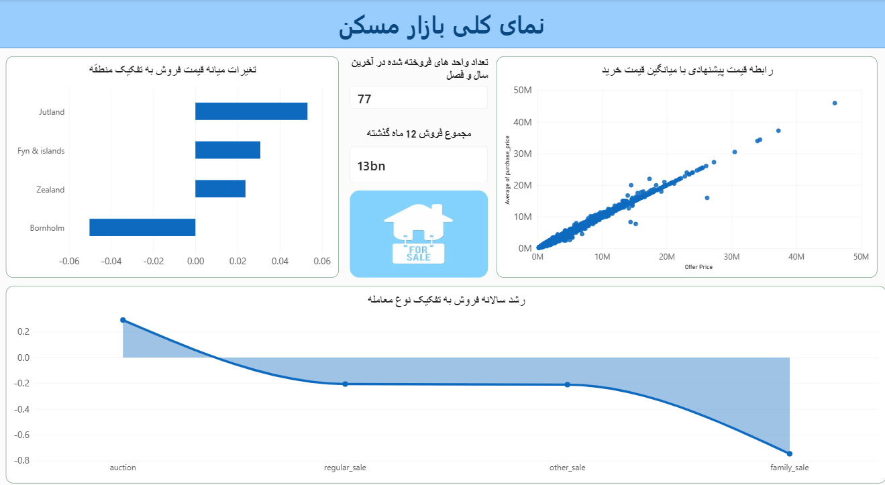
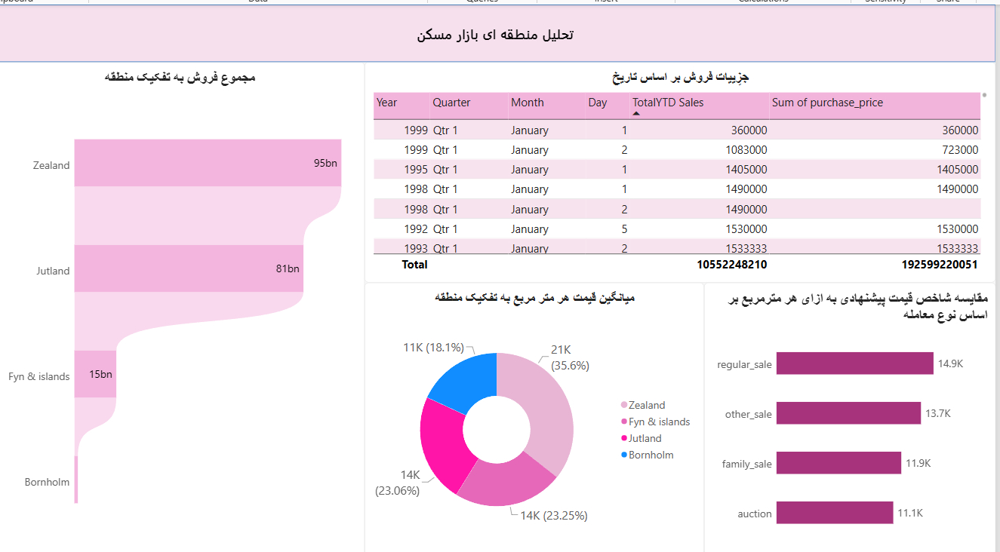
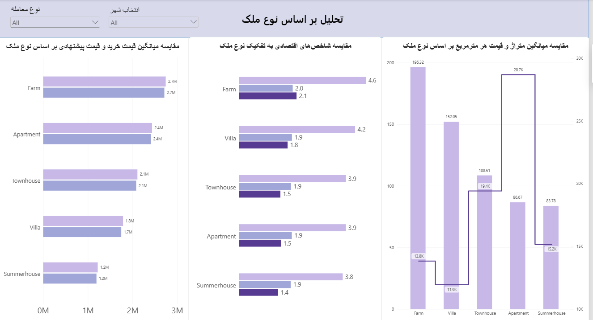

 # گزارش تحلیلی بازار مسکن (Housing Market Analysis)

## معرفی گزارش

این گزارش بر اساس داشبورد طراحی‌شده در Power BI تهیه شده و با هدف بررسی
وضعیت بازار مسکن از نظر حجم معاملات، تغییرات قیمت، تفاوت‌های منطقه‌ای، نوع
معاملات، ویژگی‌های املاک و شاخص‌های اقتصادی ارائه می‌شود.

تحلیل‌ها در سه بخش اصلی تنظیم شده‌اند:

1.  نمای کلی بازار مسکن
2.  تحلیل منطقه‌ای بازار مسکن
3.  تحلیل قیمت و ویژگی‌های املاک

------------------------------------------------------------------------

## ۱. نمای کلی بازار مسکن (House Market Overview)

### بینش‌های کلیدی (Key Insights)

#### ۱.۱. تفاوت عملکرد مناطق در تغییرات قیمت فروش

-   منطقه Jutland با رشد حدود ۵ درصدی، بیشترین تغییر مثبت را در شاخص
    میانه تغییرات قیمت فروش نشان می‌دهد.
-   مناطق Fyn & Islands و Zealand نیز تغییرات مثبت داشته‌اند.
-   منطقه Bornholm با تغییری حدود منفی ۵ درصد، ضعیف‌ترین عملکرد را در این
    شاخص ثبت کرده است.

این نتایج نشان‌دهنده تفاوت روند قیمت مسکن میان مناطق مختلف است.

#### ۱.۲. تغییرات رشد فروش بر اساس نوع معامله

بر اساس نمودار رشد سالانه فروش (YOY Sales Growth):

-   Auction عملکرد مثبت دارد.
-   Regular Sale و Other Sale رشد منفی و نسبتاً مشابهی دارند.
-   Family Sale با افتی حدود ۷۵ درصدی، بیشترین کاهش را تجربه کرده است.

بنابراین، روند فروش در همه روش‌های معامله یکسان نیست و گروه Family Sale
به بررسی دقیق‌تری نیاز دارد.

#### ۱.۳. حجم فعالیت بازار

-   تعداد واحدهای فروخته‌شده در آخرین سال و فصل: ۷۷ واحد
-   مجموع فروش در ۱۲ ماه گذشته: حدود ۱۳ میلیارد

این شاخص‌ها تصویری از حجم فعالیت بازار ارائه می‌کنند. برای ارزیابی دقیق‌تر
عملکرد، مقایسه آن‌ها با دوره‌های زمانی قبلی ضروری است.

#### ۱.۴. ارتباط قیمت پیشنهادی و قیمت خرید

نمودار پراکندگی (Scatter Plot) نشان می‌دهد میان قیمت پیشنهادی و میانگین
قیمت خرید رابطه‌ای مثبت و قوی وجود دارد؛ به این معنا که با افزایش قیمت
پیشنهادی، قیمت خرید نیز عموماً افزایش می‌یابد.

با این حال، تعدادی از معاملات با قیمت‌های بالا از الگوی اصلی فاصله دارند
و می‌توانند به‌صورت جداگانه بررسی شوند.

### اقدامات پیشنهادی (Recommended Actions)

1.  **تمرکز بر مناطق دارای رشد مثبت:** بررسی فرصت‌های سرمایه‌گذاری در
    Jutland و شناسایی عواملی که باعث عملکرد بهتر این منطقه شده‌اند.
2.  **بررسی افت عملکرد Bornholm:** تحلیل عرضه، تقاضا، تعداد معاملات و
    تغییرات قیمت برای شناسایی دلایل کاهش شاخص قیمت.
3.  **تحلیل Family Sale:** بررسی علت افت شدید رشد فروش این گروه و مقایسه
    آن با سایر روش‌های معامله.
4.  **پایش اختلاف قیمت پیشنهادی و خرید:** محاسبه درصد اختلاف این دو قیمت
    برای شناسایی مواردی که قیمت پیشنهادی با قیمت نهایی معامله فاصله
    زیادی دارد.
5.  **بررسی معاملات پرت:** شناسایی معاملات با قیمت‌های بسیار بالا و بررسی
    اثر آن‌ها بر میانگین قیمت‌ها.

------------------------------------------------------------------------

## ۲. تحلیل منطقه‌ای بازار مسکن (Regional Market Analysis)

### بینش‌های کلیدی (Key Insights)

#### ۲.۱. تمرکز حجم معاملات در مناطق اصلی

بر اساس نمودار مجموع فروش به تفکیک منطقه:

-   منطقه Zealand با حدود ۹۵ میلیارد، بیشترین حجم فروش را دارد.
-   Jutland با حدود ۸۱ میلیارد در رتبه دوم قرار گرفته است.
-   دو منطقه Zealand و Jutland بخش عمده فعالیت بازار را به خود اختصاص
    داده‌اند.
-   Bornholm کمترین حجم فروش را دارد.

#### ۲.۲. تفاوت سطح قیمت هر مترمربع در مناطق

بر اساس نمودار میانگین قیمت هر مترمربع:

-   Zealand با حدود ۲۱ هزار، بالاترین میانگین قیمت هر مترمربع را دارد.
-   Fyn & Islands و Jutland هرکدام حدود ۱۴ هزار هستند.
-   Bornholm با حدود ۱۱ هزار، پایین‌ترین میانگین قیمت هر مترمربع را ثبت
    کرده است.

#### ۲.۳. تفاوت شاخص نمایش‌داده‌شده بر اساس نوع معامله

Regular Sale بالاترین مقدار و Auction پایین‌ترین مق
**: دار را دارد. این
اختلاف می‌تواند نشان‌دهنده تفاوت در سطح قیمت یا ترکیب معاملات در روش‌های
مختلف فروش باشد؛ با این حال، برای تفسیر قطعی باید تعریف دقیق شاخص و واحد
اندازه‌گیری آن بررسی شود.

#### ۲.۴. جزئیات فروش در طول زمان

جدول اطلاعات داشبورد، جزئیات فروش را بر اساس سال، فصل، ماه و روز نمایش
می‌دهد و امکان بررسی روند معاملات در بازه‌های زمانی مختلف را فراهم می‌کند.

### اقدامات پیشنهادی (Recommended Actions)

1.  **حفظ سهم بازار در Zealand و Jutland:** بررسی عوامل موفقیت این مناطق
    و تمرکز بر فرصت‌های توسعه در آن‌ها.
2.  **بررسی فرصت‌های رشد در Fyn & Islands:** تحلیل ظرفیت افزایش معاملات و
    جذب خریداران جدید.
3.  **تحلیل وضعیت Bornholm:** بررسی پایین بودن حجم فروش و قیمت هر
    مترمربع برای شناسایی فرصت‌های بهبود عملکرد.
4.  **تدوین استراتژی قیمت‌گذاری منطقه‌ای:** استفاده از قیمت هر مترمربع
    به‌عنوان یکی از معیارهای مقایسه و ارزیابی قیمت املاک.
5.  **مقایسه روش‌های فروش:** بررسی تفاوت مقادیر شاخص در روش‌های مختلف
    معامله و ارزیابی عملکرد هر روش.
6.  **پایش روند زمانی معاملات:** استفاده از اطلاعات روزانه، ماهانه و
    فصلی برای شناسایی دوره‌های افزایش یا کاهش فعالیت بازار.

------------------------------------------------------------------------

## ۳. تحلیل قیمت و ویژگی‌های املاک (Property Analysis)

### بینش‌های کلیدی (Key Insights)

#### ۳.۱. تفاوت قیمت خرید و قیمت پیشنهادی در انواع ملک

بر اساس نمودار میانگین قیمت خرید و میانگین قیمت پیشنهادی:

 - Farm بالاترین میانگین قیمت خرید و پیشنهادی را دارد.
-   apartment در رتبه دوم قرار دارد.
-   summerhouse  پایین‌ترین میانگین قیمت را نشان می‌دهد.

#### ۳.۲. تفاوت متراژ و قیمت هر مترمربع

بر اساس نمودار میانگین متراژ و میانگین قیمت هر مترمربع:

-   Farm با میانگین ۱۸۱ مترمربع، بیشترین متراژ را دارد.
-   apartment با میانگین ۸۰ مترمربع، کمترین متراژ را دارد؛ اما
    بالاترین قیمت هر مترمربع را ثبت کرده است.

این نتایج نشان می‌دهد قیمت کل ملک به‌تنهایی معیار مناسبی برای مقایسه ارزش
املاک نیست و متراژ و قیمت هر مترمربع نیز باید در تحلیل لحاظ شوند.

#### ۳.۳. تفاوت شاخص‌های اقتصادی میان انواع ملک

مقادیر نمایش‌داده‌شده در نمودار شاخص‌های اقتصادی عبارت‌اند از:

**: Average of Yield on Mortgage Credit Bonds (%): میانگین بازده اوراق قرضه رهنی (%)
**: Average of Nominal Interest Rate (%): میانگین نرخ بهره اسمی (%
**: Average of DK Annual Inflation Rate (%): میانگین نرخ تورم سالانه دانمارک (%)\

-   بازده اوراق رهنی و نرخ تورم و نرخ بهره اسمی در Farm بالاترین مقدار را دارد.

این شاخص‌ها برای بررسی شرایط اقتصادی بازار مسکن مفید هستند؛ اما به‌تنهایی
رابطه علت و معلولی میان نرخ‌های اقتصادی و قیمت املاک را اثبات نمی‌کنند.

### اقدامات پیشنهادی (Recommended Actions)

1.  **قیمت‌گذاری بر اساس نوع ملک:** برای Summerhouse، Farm و Villa مدل‌های
    قیمت‌گذاری جداگانه طراحی شود.
2.  **توجه به قیمت هر مترمربع:** هنگام ارزیابی ارزش ملک، علاوه بر قیمت
    کل، متراژ و قیمت واحد سطح نیز بررسی شود.
3.  **شناسایی فرصت‌های سرمایه‌گذاری:** Summerhouse از نظر ارزش بالاتر هر
    مترمربع و Farm از نظر متراژ بیشتر و قیمت واحد سطح پایین‌تر بررسی
    شوند.
4.  **پایش شاخص‌های اقتصادی:** تغییرات نرخ بهره، تورم و بازده اوراق رهنی
    در کنار روند معاملات مسکن بررسی شود.
5.  **تحلیل حساسیت قیمت‌ها:** ارتباط تغییرات نرخ بهره و تورم با تغییر
    قیمت خرید و حجم معاملات در دوره‌های مختلف بررسی شود.

                                   
  -----------------------------------------------------------------------

## ۴. اقدامات اولویت‌دار برای مدیریت (Strategic Recommendations)

### اولویت بالا

**۱. بررسی افت عملکرد Family Sale**

افت حدود ۷۵ درصدی رشد فروش این گروه نیازمند بررسی علت کاهش معاملات،
شرایط فروش و رفتار خریداران است.

**۲. بررسی وضعیت بازار Bornholm**

تحلیل کاهش شاخص قیمت و حجم فروش این منطقه و شناسایی عوامل مؤثر بر عملکرد
ضعیف‌تر آن.

### اولویت متوسط

**۳. توسعه بازار در Zealand و Jutland**

حفظ موقعیت مناطق پرفروش و شناسایی فرصت‌های جدید سرمایه‌گذاری و توسعه
بازار.

**۴. بهینه‌سازی استراتژی قیمت‌گذاری**

استفاده هم‌زمان از قیمت هر مترمربع، نوع ملک، منطقه و اختلاف قیمت پیشنهادی
و خرید برای ارزیابی و تعیین قیمت رقابتی.

### اولویت بلندمدت

**۵. توسعه مدل پیش‌بینی بازار**

بررسی ارتباط نرخ بهره و تورم با قیمت مسکن و حجم معاملات و استفاده از
نتایج برای پیش‌بینی روندهای آینده.

------------------------------------------------------------------------

## ۵. نتیجه‌گیری نهایی (Final Conclusion)

تحلیل داده‌های بازار مسکن نشان می‌دهد که عملکرد بازار در مناطق و انواع
مختلف املاک یکسان نیست. Zealand از نظر حجم فروش و میانگین قیمت هر
مترمربع در جایگاه بالاتری قرار دارد، در حالی که Jutland روند مثبت‌تری در
تغییرات قیمت فروش نشان می‌دهد.

از طرف دیگر، تفاوت قابل‌توجه میان قیمت هر مترمربع انواع ملک و افت رشد
فروش در Family Sale نشان می‌دهد که اتخاذ یک استراتژی یکسان برای تمام
مناطق و روش‌های فروش نمی‌تواند بهترین نتیجه را به همراه داشته باشد.

پیشنهاد می‌شود مدیریت با تمرکز بر بازارهای دارای پتانسیل رشد، شناسایی
عوامل کاهش معاملات در مناطق ضعیف‌تر و طراحی استراتژی قیمت‌گذاری متناسب با
نوع ملک و منطقه، برای افزایش بازده معاملات و بهبود تصمیم‌گیری سرمایه‌گذاری
اقدام کند.

------------------------------------------------------------------------

## ۶. نتیجه مورد انتظار از اقدامات پیشنهادی

اجرای اقدامات پیشنهادی می‌تواند به نتایج زیر کمک کند:

-   شناسایی مناطق دارای فرصت رشد و سرمایه‌گذاری.
-   بهبود تصمیم‌گیری در قیمت‌گذاری املاک.
-   شناسایی عوامل کاهش معاملات در برخی روش‌های فروش.
-   درک بهتر تفاوت ارزش املاک بر اساس نوع و متراژ.
-   پایش اثر شاخص‌های اقتصادی بر روند بازار.
-   فراهم کردن مبنایی داده‌محور برای تصمیم‌گیری‌های مدیریتی.
